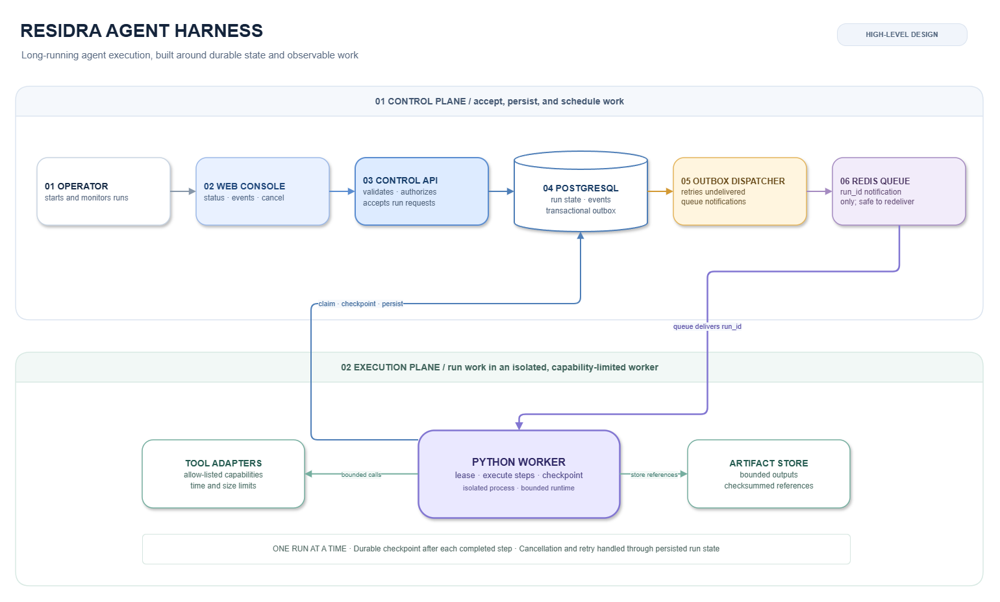
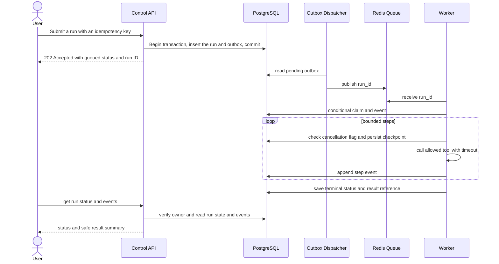

# Residra Agent Harness
## High-Level Design Project Report


**Long-Running Agent Execution & Orchestration Platform**  
**Subject:** System Design · **Institution:** Chandigarh University  
**Project status:** Proposed design for academic review; implementation and measured results are not claimed.

> **Abstract.** Residra Agent Harness is a proposed student-scale platform for starting, tracking, and safely stopping long-running software-agent tasks. A web console submits a run to a control API. The API persists the run and an outbox record together; a dispatcher then publishes the run identifier to a queue. A separate worker claims the run, executes bounded steps through allow-listed tool adapters, and writes checkpoints and events to PostgreSQL. This separation keeps web requests short while work continues beyond a browser session. The report defines a practical first release, its state transitions, interfaces, data model, security boundaries, and operational assumptions. The problem framing and design details were developed from the supplied topic as reasonable project assumptions and should be reviewed by the team before implementation.

## Team and planned contributions

These are **proposed responsibilities**, not a record of completed work.

| Member | UID | Planned role and responsibilities |
|---|---|---|
| Arshdeep Singh | 24BCS10184 | Product framing, requirements, estimates, and user workflow |
| Abhineet | 24BCS10039 | Architecture, API contracts, queue flow, and recovery behavior |
| Arushi Garg | 24BCS11147 | Data model, security, operations, risks, and report consistency |

## Contents

1. Project definition
2. Requirements and estimates
3. Architecture and workflow
4. Interfaces and data
5. Security, reliability, and operations
6. Testing, risks, and next steps
7. References

## 1. Project definition

### Problem and users

An agent task may need several tool calls, waits, retries, and checkpoints. If the request is handled only inside one web request, a browser disconnect or server timeout can make progress hard to inspect and recovery difficult. For a university-scale prototype, the realistic problem is therefore **durable orchestration of a limited number of long-running runs**, not autonomous general intelligence.

The primary users are students or developers who start tasks and need to see their state, inspect a bounded event history, and request cancellation. A project operator can also review failed runs. The harness schedules and records work; it does not decide whether an agent's output is correct.

### Objectives and scope

The first release should let an authenticated user create a run from a registered agent configuration, receive a run ID immediately, view state and recent events, cancel an active run, and inspect its final result or safe error summary. The worker runs a finite step loop and records each step boundary. A small web interface can expose a run list and a run detail page with status, timestamps, events, cancellation, and a link to an output artifact.

**In scope:** single-project user accounts; one run per request; queued, running, succeeded, failed, cancelled states; a modest retry policy for transient tool failures; a relational event history; bounded artifacts; and a single deployment composed of API, dispatcher, queue, database, and worker process.

**Out of scope:** multi-tenant enterprise billing, agent marketplace, unrestricted shell access, multi-region failover, Kubernetes, distributed workflow graphs, arbitrary parallel branches, and claims of safe autonomous execution. Human review remains necessary for consequential outputs.

### Assumptions and constraints

This design assumes a small course demonstration with a few dozen named users, one trusted project environment, one active worker pool, and tasks that can be expressed as discrete steps. External model and tool credentials are configured by an operator and never returned to the browser. The team has not supplied implementation details; all design choices here are proposals. The system depends on network access to its database and queue, so its behavior during an outage is part of the design rather than an assumed success.

## 2. Requirements and estimates

### Functional requirements

| ID | Requirement |
|---|---|
| FR-1 | An authenticated owner can submit a task using an enabled agent configuration and an idempotency key. |
| FR-2 | The system creates a durable run record and returns its identifier without waiting for execution. |
| FR-3 | The owner can retrieve run state, timestamps, recent ordered events, and a safe result summary. |
| FR-4 | The owner can request cancellation; the worker checks at step boundaries and records the outcome. |
| FR-5 | Transient tool failures can retry within a configured limit; exhausted or permanent errors fail the run. |
| FR-6 | An operator can inspect queue age and run failures without seeing secrets in logs. |

### Non-functional goals (design targets, not measurements)

| Quality | Proposed target | Rationale |
|---|---|---|
| API responsiveness | P95 under 500 ms for create/status calls under 20 concurrent users, excluding external tool time | Long work should not occupy the HTTP request. This is an acceptance goal to measure later. |
| Durability | A run accepted with HTTP 202 survives API process restart | The run and outbox event commit in one PostgreSQL transaction. |
| Recovery | A worker crash leaves a recoverable non-terminal run; duplicate queue notices do not create a second logical run | PostgreSQL state is authoritative; worker claims and step records are idempotent. |
| Cancellation | Cancellation is observed at the next safe step boundary, with a design goal of under 10 seconds for a responsive worker | A blocked external call may delay cancellation. |
| Access control | A user may read or cancel only runs they own; operator access is explicit | Prevents cross-user disclosure and unauthorized state changes. |
| Maintainability | API and worker can be run locally as separate processes with documented configuration | Fits a student project and permits focused testing. |

### Back-of-the-envelope sizing

Assume 20 users, each starting 3 runs per working day, for 20 working days per month: `20 × 3 × 20 = 1,200 runs/month`. At 25 persisted events per run and an average 2 KB of event metadata, event payload growth is about `1,200 × 25 × 2 KB = 60,000 KB`, roughly 60 MB/month before indexes and row overhead. Budgeting 2× for database overhead gives about 120 MB/month, or 1.44 GB/year. Large outputs must not be stored in the event table; store bounded files separately and keep metadata plus a reference in PostgreSQL. These are planning estimates, not measured usage.

At a burst of 20 simultaneous submissions, the HTTP API should enqueue quickly and the queue should absorb work until a worker is free. A two-worker student deployment is a reasonable starting point; it gives no high-availability guarantee. If each run has a 4-minute average tool wait, two workers process roughly 30 runs/hour in ideal serial arithmetic (`2 × 60 / 4`); actual throughput may be lower due to variable calls and retries. The team should measure rather than promise capacity.

## 3. Architecture and workflow

### Component view

The diagram below is the editable design source's matching Mermaid rendering. The central rule is that PostgreSQL owns run truth; the queue carries notifications and can be rebuilt from pending outbox rows.

**Figure 1.** Proposed HLD: request acceptance is separate from task execution; the worker persists checkpoints while it runs.



| Component | Responsibility | Student-scale choice |
|---|---|---|
| Web console | Submit a run and inspect/cancel owned runs | Small React or server-rendered UI; kept thin so API rules remain authoritative |
| Control API | Validate input, authorize ownership, accept commands, return status | Python FastAPI; its official documentation describes generated OpenAPI interface docs (FastAPI metadata) |
| PostgreSQL | Canonical run state, ordered events, idempotency, transactional outbox | Relational constraints and transactions suit auditable state transitions (PostgreSQL documentation) |
| Outbox dispatcher + Redis | Deliver pending run IDs to workers; queue can be reconstructed from outbox | Redis lists support producer-consumer queue patterns (Redis Lists) |
| Worker + tool adapters | Claim runs, execute bounded steps, checkpoint, enforce allow-list | Python process, separated from public API so work can outlive a client connection |
| Artifact store | Hold capped output files; database stores keys, sizes, and checksums | Local filesystem for a demo, replaceable with an object store later |

### Main run lifecycle

1. The browser sends a create request with an idempotency key. The API checks authentication, payload size, known agent configuration, and quotas.
2. In a single database transaction, the API inserts `AgentRun` in `QUEUED` and an `OutboxEvent` describing the new run. It then returns HTTP 202 with `run_id` and `status`.
3. The dispatcher reads unprocessed outbox rows, publishes a run ID to Redis, and marks the row delivered. If a crash occurs after publish but before marking, a duplicate notification is possible by design.
4. A worker receives the ID and atomically claims the queued run by moving it to `RUNNING` only if it is still eligible. If another worker already claimed it, the duplicate is acknowledged without re-executing the whole run.
5. For each step, the worker checks cancellation, persists a start event, invokes only an allow-listed adapter with a timeout, and persists completion/checkpoint data. Transient failures use bounded exponential backoff; permanent failures do not retry.
6. The worker stores a final summary and changes state to `SUCCEEDED`, `FAILED`, or `CANCELLED`. The UI polls status and events; a future version could stream updates.



## 4. Interfaces and data

### API surface

All endpoints are versioned under `/v1`. Authentication is via a short-lived bearer token from the configured identity provider; every run endpoint also enforces ownership.

| Method | Path | Purpose | Access |
|---|---|---|---|
| `POST` | `/v1/runs` | Create run; accepts `agent_id`, `input`, idempotency key | Authenticated owner |
| `GET` | `/v1/runs/{run_id}` | Read state, timestamps, safe result summary | Run owner / operator |
| `GET` | `/v1/runs/{run_id}/events?after={id}` | Read paginated event history | Run owner / operator |
| `POST` | `/v1/runs/{run_id}/cancel` | Request cancellation if state permits | Run owner / operator |
| `GET` | `/v1/health` | Liveness check only; no secrets or dependency details | Public or internal probe |

Representative request:

```http
POST /v1/runs
Authorization: Bearer <token>
Idempotency-Key: 01J...client-generated...
Content-Type: application/json

{"agent_id":"research-assistant-v1","input":{"question":"Summarize these course notes"}}
```

Representative response:

```json
{"run_id":"run_01JABC","status":"QUEUED","created_at":"2026-11-01T10:00:00Z"}
```

Errors have a consistent public shape and avoid stack traces:

```json
{"error":{"code":"RUN_NOT_FOUND","message":"The requested run was not found.","request_id":"req_01JXYZ"}}
```

Expected status mapping: `400` invalid input/state, `401` unauthenticated, `403` not permitted, `404` missing or deliberately hidden foreign run, `409` idempotency/state conflict, `429` quota exceeded, `500` unexpected server error, `503` temporary dependency outage. The create call returns `202 Accepted` only after database commit.

### Basic data model

The architecture needs three primary records plus outbox delivery tracking:

| Entity | Important fields | Purpose |
|---|---|---|
| `User` | `user_id` UUID PK, `email` UNIQUE, `display_name`, `created_at` | Owns runs; identity credentials are external, not stored here |
| `AgentDefinition` | `agent_id` text PK, `version`, `enabled`, `tool_allowlist` JSONB, `max_steps`, `timeout_seconds` | Versioned configuration and safety limits for a run |
| `AgentRun` | `run_id` UUID PK, `owner_id` FK, `agent_id` FK, `status`, `input_json`, `result_json`, `idempotency_key`, `attempt`, `cancel_requested_at` (nullable), `created_at`, `updated_at`, `started_at`, `finished_at` | Canonical run state, cancellation request, and compact result metadata |
| `RunEvent` | `event_id` bigserial PK, `run_id` FK, `sequence_no`, `event_type`, `payload_json`, `created_at` | Ordered audit trail/checkpoints; unique `(run_id, sequence_no)` |
| `OutboxEvent` | `outbox_id` UUID PK, `run_id` FK, `event_type`, `created_at`, `delivered_at`, `attempts` | Reliable dispatch record written alongside run creation |

## 5. Security, reliability, and operations

### Security boundaries

Use HTTPS for all remote traffic. Validate bearer tokens and apply authorization inside every API handler; the browser must not decide ownership. Keep the tool allow-list and step/time/size caps in trusted configuration. The worker runs with a restricted service account and no general shell access. Tool credentials are injected server-side, scoped to least privilege, and redacted from request logs. Treat user input and tool output as untrusted data; encode it in the UI and never execute returned text as code. Artifact download should require ownership checks and short-lived access links. OWASP recommends HTTPS, endpoint-level access control, validation, and generic error responses for REST services.

### Error and retry behavior

The API fails closed on auth or validation errors. On a temporary database failure it does not claim acceptance; it returns `503` with a request ID so the client can retry using the same idempotency key. The outbox dispatcher retries delivery and keeps the row pending until acknowledged. Because queue delivery may repeat, the worker treats a run ID as a notification, not permission to duplicate execution: only one conditional database claim may move a run to `RUNNING`. Worker leases include a heartbeat and expiry; a supervisor may return a stale `RUNNING` run to `QUEUED` only after recording a recovery event and checking the attempt limit.

Tool calls have explicit timeout and retry classification. Retry only transient network/rate-limit failures, up to three attempts with capped exponential backoff plus jitter; do not blindly retry invalid requests or side-effecting calls without an idempotency contract. Cancellation changes an active run's cancellation flag/state, and the worker observes it between calls. A tool call already in flight may complete before cancellation is recorded. Terminal states are immutable except for an explicit operator recovery action recorded in the audit trail.

### Logging and monitoring

Use structured logs with `request_id`, `run_id`, `owner_id` pseudonym, component, event type, duration, and outcome. Exclude bearer tokens, raw prompts, secret values, and full artifact contents. Track API request count/error rate/latency, queue depth and oldest message age, active worker count, run duration by terminal state, retries, and cancellation delay. A simple dashboard and log search are sufficient for a course prototype. OpenTelemetry provides common tracing, metric, and log signal concepts if the team later adds instrumentation.

### Basic UI sketch

```text
Runs  [New run]
---------------------------------------------------------
Run ID       Agent             State       Updated
run_01JABC   research-v1       RUNNING     10:04
run_01JABD   code-review-v1    SUCCEEDED   09:58

run_01JABC · RUNNING                 [Request cancellation]
Created 10:00 · Started 10:01 · Attempt 1 of 3
Timeline: queued → worker claimed → step 1 complete → step 2 running
Result: available after completion; event payloads are paginated
```

## 6. Testing, risks, and next steps

The design calls for unit tests of state transitions, payload validation, retry classification, and ownership checks; API integration tests for create/idempotency/read/cancel; worker tests with fake tool adapters; and a failure-injection test that stops the dispatcher or worker between steps. Acceptance testing should verify that a committed run is recoverable after restart, a duplicate queue message does not duplicate a run, cancellation is eventually observed, and one user's ID cannot reveal another user's output. No test execution or performance measurement is claimed in this report.

| Risk / trade-off | Mitigation or accepted limit |
|---|---|
| Duplicate delivery or worker crash | Database claims, event sequence constraints, leases, and restart recovery; do not promise exactly-once external side effects |
| Long or stuck external calls | Per-call timeout, worker heartbeat, concurrency cap; cancellation may wait until a call returns |
| Prompt/output contains sensitive data | Minimize retention, restrict access, redact logs, and use synthetic demo data |
| Redis loss | Rebuild notifications from undelivered outbox rows and eligible queued runs |
| Single deployment/database outage | Clear 503 behavior and documented backup; no high-availability claim in the prototype |
| Scope becomes too broad | Keep one linear run with bounded steps; defer branching workflows and multi-tenant policy |

Potential next increments are server-sent event updates, per-project quotas, configurable retention, encrypted object storage, and a human approval step before sensitive tool actions. Each should follow evidence from the first measured prototype rather than being treated as a current capability. OpenTelemetry defines common tracing, metric, and log signal concepts for later instrumentation.

## 7. References

- FastAPI. Metadata and docs URLs.
- PostgreSQL. Official documentation.
- Redis. Lists data type.
- OWASP. REST Security Cheat Sheet.
- OpenTelemetry. Signals.

